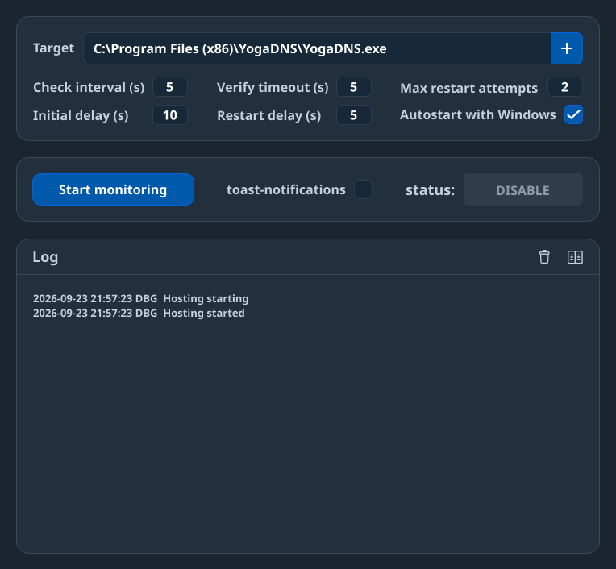

# ProcessGuardian

A lightweight Windows background utility that monitors a user-specified executable and restarts it if it crashes or disappears. WPF on .NET 9, Clean Architecture (Domain → Application → Infrastructure → Presentation).

Two editions build from the same sources:

| Edition | Executable | Manifest | Config | Autostart |
|---------|-----------|----------|--------|-----------|
| Regular (Debug/Release) | `ProcessGuardian.exe` | default (`asInvoker`) | `%LocalAppData%\ProcessGuardian\settings.json` | HKCU `...\CurrentVersion\Run` |
| Admin (Release-Elevated) | `ProcessGuardianAdmin.exe` | `requireAdministrator` | `%ProgramData%\ProcessGuardianAdmin\settings.json` (Administrators-only ACL) | Scheduled task, logon, highest privileges |

The admin edition can monitor and restart elevated targets (its own checks run with the same rights); the regular edition cannot.

## Build & Publish

Run from the repository root (Windows PowerShell):

```
powershell -NoProfile -ExecutionPolicy Bypass -File .\build\publish.ps1
```

The script publishes self-contained single-file builds. Flags to build a single profile:

- no arguments → both editions
- `-SelfContained` → `publish/self-contained` (Release)
- `-Admin` → `publish/self-contained-admin` (Release-Elevated)

Both editions are also built and tested in CI (`Release` and `Release-Elevated` solution configurations).

Output sizes (self-contained single exe):

| Edition | Output size | SPEC goal |
|---------|-------------|-----------|
| ProcessGuardian | ≈ 78 MB | NFR-06 ≤ 55 MB (not met) |
| ProcessGuardianAdmin | ≈ 78 MB | NFR-06 ≤ 55 MB (not met) |

Reason in one sentence: the `net9.0-windows10.0.17763.0` TFM pulls in the Windows SDK bindings, and WPF does not trim well in single-file mode.



## Installation / Run

- **Self-contained:** run the exe — a single standalone file, no runtime or external assets needed. Native libraries are extracted to `%TEMP%` on first launch, so the first start is slightly slower.
- `--background` — start in the tray without a window (used for autostart).
- Closing the window (×) hides to tray; it does not exit the process.
- Exit via the **Exit** item in the tray menu.
- Launching the exe a second time activates/shows the window of the already-running instance; the new process exits immediately.

Debug builds: `src\ProcessGuardian.Wpf\bin\Debug\net9.0-windows10.0.17763.0\ProcessGuardian.exe` (regular) and `src\ProcessGuardian.Wpf\bin\Release-Elevated\net9.0-windows10.0.17763.0\ProcessGuardianAdmin.exe` (admin; only the Release-Elevated configuration exists for the admin edition).

## Usage

- **Browse…** → absolute path to the target `.exe`.
- Check interval, initial delay, max attempts (0 = infinite), restart delay, startup verification timeout.
- **Start / Stop Monitoring**: on Start the target's SHA-256 hash is pinned; recovery restarts are verified against the pin — a changed binary blocks relaunch (red "Target Changed" card) and disables monitoring until Start is pressed again.
- Exhausted restart budget → status Error, monitoring disabled (no cooldown; re-Start resets the budget).
- **Autostart with Windows** → regular: `HKCU\...\CurrentVersion\Run` value `"<path>" --background`; admin: scheduled task `ProcessGuardianAdmin` (logon, highest privileges, silent).
- Settings: see the editions table above.
- File logs: `%LocalAppData%\ProcessGuardian\logs\` (regular; append-only `logs.log`, 512 KB rotation) — admin logs live in the same place under the admin folder name.

## Tray

- **Off** — stopped
- **On** — Waiting/Monitoring/Restarting
- **Error** — Error
- Menu: Show, Start/Disable, Exit (width adapts to the edition's labels)
- Double-click — show window

## Manual Acceptance Tests

Run manually by a person after a build (no automated pass marks here):

| # | Scenario | Expected Result |
|---|----------|-----------------|
| 1 | Launch app, set target to `calc.exe`, click Start | Status → Monitoring, tray icon green |
| 2 | Close window (×) | Window hides, tray icon remains, monitoring continues |
| 3 | Kill target process | Process restarts, toast appears, log updated |
| 4 | Set max attempts = 1, kill target twice | After 2nd failure: status Error, monitoring disabled, tray red |
| 5 | Launch second instance | First instance window activates (or tray stays), second exits immediately |
| 6 | Enable autostart, restart Windows *(optional — requires a Windows reboot)* | App starts in background (no window), tray visible, monitoring active if enabled |
| 7 | Delete target .exe while monitoring | Status Error, no crash, log shows file not found |
| 8 | Change check interval while monitoring | New interval applied within one cycle (≤ old interval seconds) |
| 9 | Delete `settings.json` while app running | App continues with defaults, recreates file on next save |
| 10 | Run without any `Assets/` folder next to the exe | Tray shows embedded icons normally — icons are embedded in the assemblies, no external files needed |
| 11 | Run on machine without Toast support *(optional — depends on environment)* | Monitoring works normally, no toasts, no crash |

## Limitations

- Distribution size NFRs (NFR-05/NFR-06) are not yet met.
- Power events (SPEC §2.7) are not implemented (`[MAY]`).
