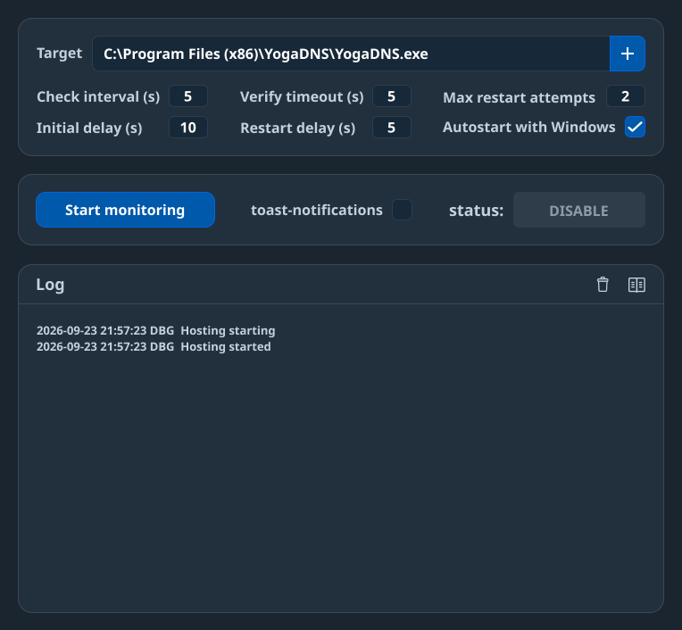

# ProcessGuardian

A lightweight Windows watchdog that monitors one selected executable and restarts it when the process is reliably confirmed to be absent.



ProcessGuardian runs in the system tray and provides two editions built from the same codebase. It works offline and is published as a self-contained, single-file application.

## Features

- **Process monitoring** — checks the exact executable path on a configurable schedule and starts the target when it is confirmed not running.
- **SHA-256 integrity protection** — records the target's hash when monitoring starts and verifies it before every automatic relaunch. A changed binary is not launched.
- **Conservative recovery** — an uncertain process or file check does not trigger a duplicate launch or consume a restart attempt.
- **System tray and notifications** — close the window without stopping monitoring; receive optional in-app notification cards.
- **Event log** — view recent events in the application and open the log file for diagnostics.

## Editions

| Edition | Executable | When to use it | Autostart |
|---|---|---|---|
| **Regular** | `ProcessGuardian.exe` | Standard user permissions | Windows Run key (current user) |
| **Elevated** | `ProcessGuardianAdmin.exe` | Monitoring targets that require administrator access | Task Scheduler (highest privileges) |

The Elevated edition requests administrator approval through UAC. Its settings are stored under `%ProgramData%` with an Administrators/SYSTEM-only security descriptor. The Regular edition stores settings under the current user's profile.

Both editions can run at the same time. Each has its own settings, log files, tray icon, and single-instance identity.

## Getting started

1. Run the edition appropriate for the target process.
2. Use **Browse** to select a local `.exe` file.
3. Adjust the monitoring settings as needed and select **Start monitoring**.
4. The application stays in the system tray. Close the window with **×** to hide it; use **Exit** in the tray menu to end the application.

The target must be specified by an absolute local-drive path. Network (UNC) paths and command-line arguments are not supported. Process matching uses the full executable path, not just the process name.

### Monitoring settings

| Setting | Default | Description |
|---|---:|---|
| Check interval | 5 s | Normal interval between process checks (1–999 s). |
| Verify timeout | 5 s | Qualification window for process appearance and continuous stable operation after launch (1–999 s). |
| Max restart attempts | 5 | Automatic process-creation attempts allowed in one monitoring session (0 = unlimited). The count resets after a stable run. |
| Initial delay | 0 s | Delay before the first monitoring action (0–999 s). |
| Restart delay | 10 s | Minimum delay before an eligible recovery launch (0–999 s); launch still follows the normal check schedule. |
| Autostart with Windows | Off | Reconcile the edition's Windows startup registration with the saved setting. |
| Toast notifications | On | Show or suppress the application's in-app notification cards. |

### Status

| Status | Meaning |
|---|---|
| **STOPPED** | Monitoring is not active. |
| **MONITORING** | The application is monitoring, waiting for an initial delay, or scheduling recovery. |
| **ERROR** | A blocking condition prevents monitoring from starting or continuing, such as a target hash mismatch or exhausted restart budget. |

A **DEGRADED** indicator may appear while monitoring is active if Windows cannot reliably establish the target's state. In that situation, ProcessGuardian waits rather than assuming the process is absent and starting another copy.

### Tray and notifications

- Double-click the tray icon to show the main window; right-click it to open the tray menu.
- The **×** window button hides the window but leaves the application running.
- Notification cards are custom in-app overlays, not Windows notification-center toasts. They disappear after five seconds and can be dismissed by clicking them.
- The `--background` argument starts the application in the tray without opening the main window. Autostart uses this mode.

**Autostart and Exit:** the saved checkbox controls the desired Windows startup behavior. At application startup, the app checks the actual registration against that setting and reconciles it when the state can be verified. In the current implementation, **Exit** ends the running application but does not clear the startup registration. Uncheck **Autostart with Windows** before exiting when you do not want it to start at the next sign-in.

## Data and logs

| Data | Regular edition | Elevated edition |
|---|---|---|
| Settings | `%LocalAppData%\ProcessGuardian\settings.json` | `%ProgramData%\ProcessGuardianAdmin\config\settings.json` |
| Logs | `%LocalAppData%\ProcessGuardian\logs.log` | `%LocalAppData%\ProcessGuardianAdmin\logs.log` |

The log view shows the latest 200 entries. The in-memory history holds up to 600 entries. The active log file rotates at 512 KiB and keeps one archive (`logs.1.log`).

## Build and publish

**Requirements:** Windows x64 and the .NET 10 SDK. The application targets Windows 10 build 17763 (version 1809) or later. Use an OS version listed in the [.NET 10 Windows support matrix](https://learn.microsoft.com/dotnet/core/install/windows); Microsoft limits Windows 10 support to the listed LTSC/Enterprise editions, not Home/Pro. The published executables are self-contained, so the .NET runtime is not required on the target machine.

Build both self-contained editions from the repository root:

```powershell
powershell -NoProfile -ExecutionPolicy Bypass -File .\build\publish.ps1
```

The script creates:

- `publish/self-contained/ProcessGuardian.exe` — Regular edition (`Release`).
- `publish/self-contained-admin/ProcessGuardianAdmin.exe` — Elevated edition (`Release-Elevated`).

To build only one edition, add `-SelfContained` or `-Admin` respectively.

To build and test the solution in both configurations:

```powershell
dotnet restore
dotnet build .\ProcessGuardian.sln -c Release
dotnet build .\ProcessGuardian.sln -c Release-Elevated
dotnet test .\ProcessGuardian.sln -c Release
dotnet test .\ProcessGuardian.sln -c Release-Elevated
```

## License

MIT. See [LICENSE](LICENSE).
